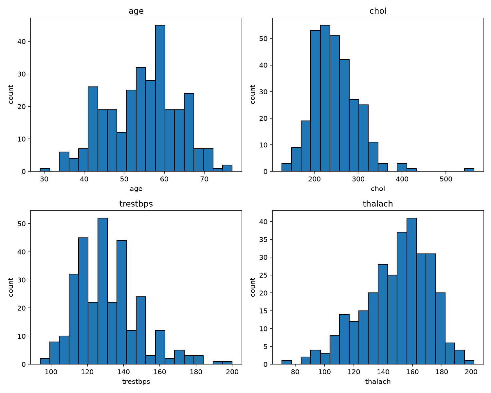
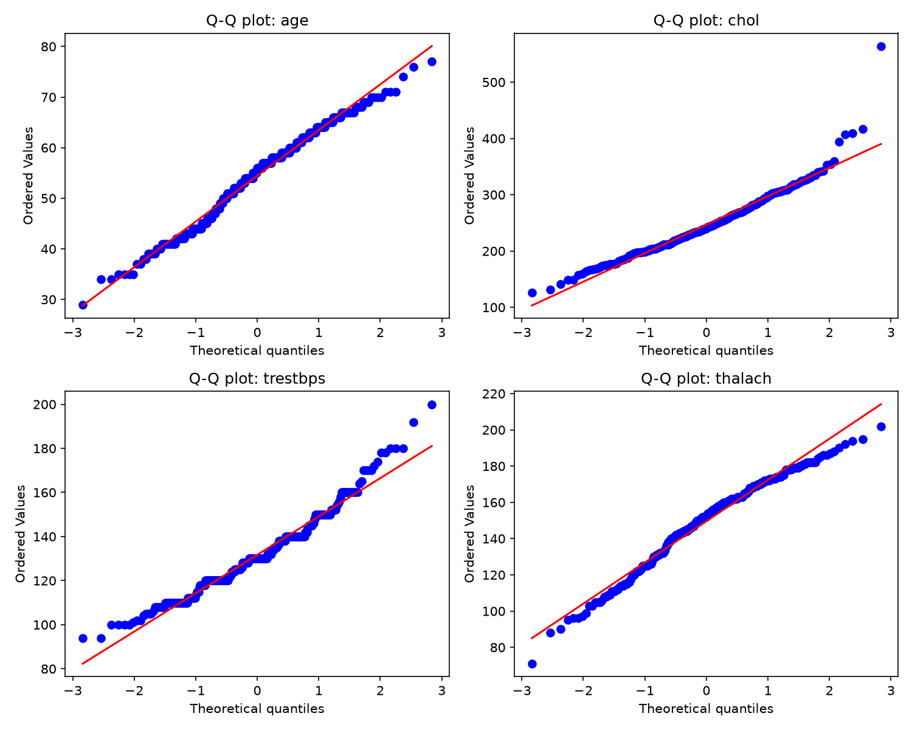
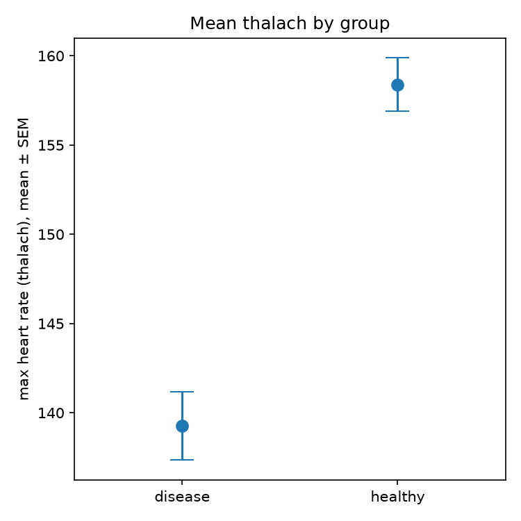
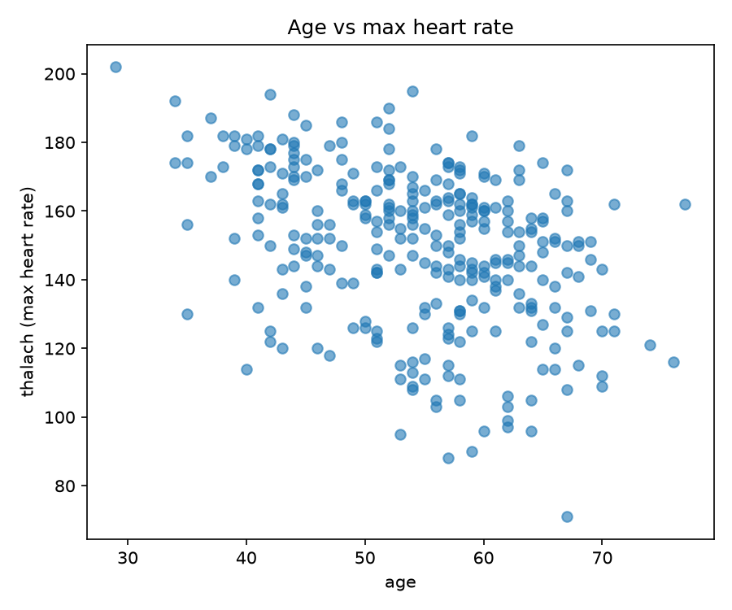
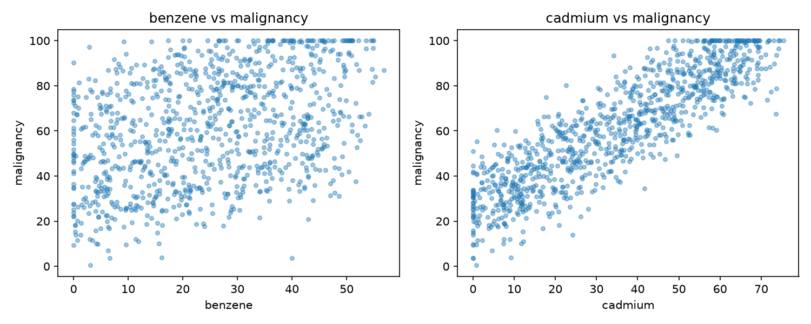
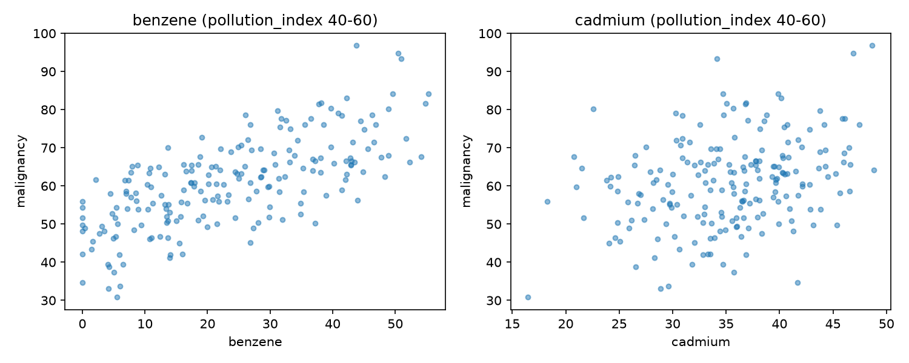

# PW3 – Data, Distributions, Testing, and Causation

Data source: Heart Disease (Cleveland), UCI Machine Learning Repository / Kaggle.

## Session 1 – Shape of the variables

- **age**: roughly bell-shaped, with one peak around 55-60 years. Values go from 29 to 77. It is a bit uneven, with a slightly longer tail towards younger patients.
- **chol**: one peak around 220-250, but the right side has a long tail, so it is skewed to the right. There is one clear outlier near 560.
- **trestbps**: one peak around 120-140, with a tail to the right up to 200, so it is skewed to the right. The bars are jagged because blood pressure is mostly recorded as round numbers.
- **thalach**: one peak around 160, with a long tail to the left down to 70, so it is skewed to the left.

## Session 1 – Normality check

I used the Shapiro-Wilk test, the skewness, and Q-Q plots (`qqplots.png`).

| variable | skewness | Shapiro-Wilk p-value | verdict |
|---|---|---|---|
| age | -0.21 | 6.1e-03 | approximately normal |
| chol | 1.13 | 5.9e-09 | not normal |
| trestbps | 0.70 | 1.8e-06 | not normal |
| thalach | -0.53 | 7.0e-05 | not normal |

- **age**: the Shapiro-Wilk p-value is below 0.05, but with 303 patients this test detects very small deviations. The skewness is close to 0 and the Q-Q plot follows the line closely, so I treat age as approximately normal.
- **chol**: strongly skewed to the right (skewness 1.13), with one outlier near 560. The Q-Q plot bends away from the line at the upper end. Not normal.
- **trestbps**: skewed to the right, and the Q-Q plot is stepped because values are mostly round numbers. Not normal.
- **thalach**: skewed to the left (skewness -0.53); the Q-Q plot deviates from the line at the lower end and the test rejects normality (p = 7e-05). I treat it as not normal, so in Session 2 I will use a method that does not assume normality.

## Session 2 – Is the effect real? (maximum heart rate, thalach)

Question: do heart-disease patients reach a different maximum heart rate than healthy ones?

Method: I split `thalach` by `target` (1 = disease, 0 = healthy). Since `thalach` is not normally distributed (Session 1), I used the Mann-Whitney U test instead of a t-test, because it does not assume normality. The test was two-sided.

| group | n | mean | median |
|---|---|---|---|
| disease | 139 | 139.26 | 142.0 |
| healthy | 164 | 158.38 | 161.0 |

Result: U = 5806.5, p = 1.9e-13.

Conclusion: p is far below 0.05, so the two groups genuinely differ. Patients with heart disease reach a lower maximum heart rate (about 19 bpm lower on average) than healthy patients.

### Mean and uncertainty

For each group I computed the mean of `thalach` and the standard error of the mean (SEM = std / sqrt(n)), which shows how precisely the mean is known.

| group | mean | SEM |
|---|---|---|
| disease | 139.26 | 1.92 |
| healthy | 158.38 | 1.50 |

The plot shows the two means with mean ± SEM error bars. The error bars are small (about 2 bpm) compared to the difference between the means (about 19 bpm), and they do not overlap at all. So the picture agrees with the Mann-Whitney result: the two groups really differ in maximum heart rate.

## Session 2 – Do age and heart rate move together?

I quantified the relationship between `age` and `thalach` with the Spearman rank correlation (it does not need normality, and `thalach` is not normal) and, for comparison, the Pearson correlation.

| method | coefficient | p-value |
|---|---|---|
| Spearman | -0.392 | 1.5e-12 |
| Pearson | -0.394 | 1.1e-12 |

Interpretation: the correlation is negative and moderate (about -0.4). Older patients tend to reach a lower maximum heart rate, and the effect is not due to chance (p is tiny), but the scatter is large, so age explains only part of the variation in heart rate.

## Dataset 2 – Chemical exposure mystery

### Naive analysis

`chemicals_cancer.csv` has 1000 patients with benzene, cadmium, pollution_index, age and malignancy. I computed the Pearson and Spearman correlation between each chemical and malignancy.

| chemical | Pearson r | Spearman rho |
|---|---|---|
| benzene | 0.385 | 0.377 |
| cadmium | 0.880 | 0.885 |

Both chemicals are positively associated with malignancy, but cadmium is far more strongly associated (about 0.88) than benzene (about 0.38). Taken at face value, cadmium appears to be the cause of malignancy. However, a strong correlation alone does not prove causation, so this needs to be checked against other variables (next section).

### Looking again: controlling for pollution_index

The correlation matrix showed that `pollution_index` is almost perfectly correlated with cadmium (0.98), strongly correlated with malignancy (0.90), and not correlated with benzene (0.05). So pollution could be a third variable (a confounder) that drives both cadmium and malignancy.

To test this I restricted the data to patients with similar pollution (40 < pollution_index < 60, 199 patients) and recomputed the correlations with malignancy inside this group.

| chemical | r, all patients | r, restricted to similar pollution |
|---|---|---|
| benzene | 0.385 | 0.702 |
| cadmium | 0.880 | 0.316 |

Result: the association of cadmium with malignancy collapses (0.88 to 0.32) once pollution is held roughly constant, while the association of benzene does not disappear, it becomes even clearer (0.39 to 0.70), because the variation caused by pollution no longer adds noise. The remaining 0.32 for cadmium is because the band is not perfectly narrow, so pollution still varies a little inside it and it is almost perfectly correlated with cadmium.

Conclusion: cadmium only looked guilty. It is correlated with malignancy because pollution raises both of them. Benzene is the chemical that really drives malignancy, since its effect survives when the confounder is controlled.

## Bonus – how unpredictable is a category?

I measured how balanced a categorical column is with the Shannon entropy, H = -sum(p * log2(p)), where p are the class proportions. For two classes H = 1 bit means a perfect 50/50 split (hardest to guess) and H close to 0 means almost everything is in one class (easy to guess). I also report the accuracy of always guessing the most common class.

| column | proportions | entropy (max 1 bit) | accuracy of guessing the majority class |
|---|---|---|---|
| target | 54.1% / 45.9% | 0.995 | 54.1% |
| sex | 68% / 32% | 0.905 | 68.0% |

`target` is almost perfectly balanced, so a category is about as hard to guess as a coin flip. `sex` is more lopsided (about two thirds of one class), so it is easier to guess.